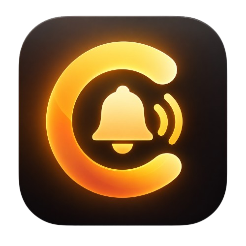

<div align="center">



# Curry

### Ambient Desktop Notification Companion & Screen-Edge Glow Utility

**Curry** transforms incoming Windows notifications into subtle, hardware-accelerated ambient screen-edge glows. Crafted with a dark desktop aesthetic and an **Amber Neon** glow signature, Curry delivers real-time awareness without disruptive popups.

<br/>

<!-- Primary Download Action Buttons -->
<p align="center">
  <a href="https://apps.microsoft.com/detail/9P2STBW88PDQ" target="_blank" rel="noopener noreferrer">
    
  </a>
  &nbsp;&nbsp;&nbsp;&nbsp;
  <a href="https://github.com/owergungor/Curry/releases/latest" target="_blank" rel="noopener noreferrer">
    
  </a>
</p>

<br/>

[](https://github.com/owergungor/Curry/releases/latest)
[-0a0e17?style=flat&logo=windows&logoColor=08a1f7)](https://github.com/owergungor/Curry)
[](https://owergungor.github.io/Curry/privacy-policy.html)
[](https://v2.tauri.app/)
[](https://svelte.dev/)
[](https://www.rust-lang.org/)
[](LICENSE)

</div>

---

## ⚡ Overview

Traditional notification toasts break your focus—they obscure active windows, block critical tools, and distract during deep work. **Curry** replaces notification friction with an elegant ambient illumination layer around your monitor edges.

- 🔶 **Native WinRT Integration**: Captures Windows 10 & 11 notifications instantaneously via `UserNotificationListener` with **0ms latency** and **zero polling overhead**.
- 🔶 **Ultra-Lightweight Engine**: Hardware-accelerated GPU glow compositing that idles at under 1% CPU.
- 🔶 **Privacy-Respecting Architecture**: Notification contents and application metadata are parsed and stored strictly on your local device.
- 🔶 **Official Documentation & Website**: [https://owergungor.github.io/Curry/](https://owergungor.github.io/Curry/)

> [!NOTE]
> Curry is distributed through the **[Microsoft Store](https://apps.microsoft.com/detail/9P2STBW88PDQ)** (Store ID: `9P2STBW88PDQ`) for automated background updates and sandboxing, as well as standalone signed installers on **[GitHub Releases](https://github.com/owergungor/Curry/releases/latest)**.

---

## 🌟 Key Features

### 1. Ambient Edge Glow Engine
- **5 Animation Styles**: `Pulse`, `Sweep`, `Ambient`, `Comet`, and `Ripple`.
- **Full Visual Control**: Granular sliders for border thickness, outer blur spread, cycle duration, and opacity.
- **Hardware-Accelerated**: Rendered via direct GPU compositing for fluid 60+ FPS animations without frame stutter.

### 2. Native WinRT Notification Stream
- Direct event-driven hook into Windows `UserNotificationListener` APIs.
- Captures incoming alerts across all desktop applications without constant process polling.
- In-memory ring buffer with real-time search, read/unread status toggling, and instant cleanup.

### 3. Auto App Discovery & Profiles
- **Auto App Scan**: One-click scanner that detects installed desktop applications from Start Menu shortcuts and Windows Registry entries.
- **Per-Application Customization**: Configure custom glow colors, animation styles, and display routing for individual applications (e.g., Slack, Teams, Outlook, Discord).
- **Flexible UI Views**: Switch seamlessly between a high-density card grid and a streamlined list view.

### 4. Gaming & Fullscreen Suppression
- Intelligently senses when a full-screen application, game, or media player is active.
- Automatically suppresses ambient glow overlays so gameplay and video playback remain completely unobstructed.

### 5. OLED Panel Burn-In Protection
- Dedicated **OLED Mode** clamps peak luminance and narrows edge spread.
- Modulates glow duration and active cycle duty to preserve QD-OLED and OLED panel longevity.

### 6. 10 Curated Artisan Themes
Curry features finely tuned color palettes designed for dark and high-contrast desktop environments:
- **Perpetuity (Standard)** — Precision obsidian slate with signature Amber Neon radiance
- **Matrix Green** — High-contrast cyber terminal emerald
- **Neon Magenta** — Midnight void with high-voltage magenta
- **Catppuccin** — Soothing pastel lavender and mocha crust
- **Amethyst Haze** — Deep violet aura with vivid amethyst accents
- **Zen Linen** — Calm organic linen and warm stone tones
- **Sage Mist** — Botanical evergreen with soft mint highlights
- **Amber Slate** — Molten warm amber and industrial slate steel
- **Sakura Dawn** — Soft cherry blossom dawn with rose quartz
- **Mocha Mousse** — Velvety espresso, warm caramel, and toasted cocoa

### 7. Multi-Monitor Display Coordination
- Route ambient edge glows to your **Primary Display**, the display housing your **Active Window**, or synchronize simultaneously across **All Monitors**.
- Native DPI-aware coordinate handling with support for mixed-resolution and negative-coordinate monitor arrangements.

---

## 🖼️ Screenshots

<div align="center">


*Curry — Amber Neon Ambient Notification Companion*

</div>

Curry's desktop interface features a dark obsidian aesthetic with tactile controls, Svelte 5 reactive runes, and immediate preview triggers for every glow mode and colorway.

---

## 📦 Downloads & Installation

Curry is available as a verified **Microsoft Store** application and as standalone release binaries on **GitHub**.

### Official Packages (v3.3)

| Package Format | Target / Filename | Size | Recommended For |
| :--- | :--- | :--- | :--- |
| **Microsoft Store** | [Store ID `9P2STBW88PDQ`](https://apps.microsoft.com/detail/9P2STBW88PDQ) | Cloud | **Recommended**: Seamless installation, automated background updates, and Windows sandboxing. |
| **Windows Setup (.exe)** | [`Curry_v3.3_win-x64-setup.exe`](https://github.com/owergungor/Curry/releases/download/v3.3/Curry_v3.3_win-x64-setup.exe) | 3.9 MB | Standard NSIS installer with Start Menu integration and auto-updater. |
| **Windows MSIX (.msix)** | [`Curry_v3.3_win-x64.msix`](https://github.com/owergungor/Curry/releases/download/v3.3/Curry_v3.3_win-x64.msix) | 5.2 MB | Modern MSIX package for clean installation and enterprise management. |
| **Portable ZIP (.zip)** | [`Curry_v3.3_win-x64.zip`](https://github.com/owergungor/Curry/releases/download/v3.3/Curry_v3.3_win-x64.zip) | 9.2 MB | Standalone portable archive. Extract anywhere and launch `Curry.exe`. |
| **Standalone Binary** | [`Curry.exe`](https://github.com/owergungor/Curry/releases/download/v3.3/Curry.exe) | 14.0 MB | Single executable without installer. |

> Cryptographic verification digests are published in [`SHA256SUMS.txt`](https://github.com/owergungor/Curry/releases/download/v3.3/SHA256SUMS.txt) alongside digital signatures (`.sig`).

---

## 🖥️ System Requirements

- **Operating System**: Windows 10 (Build 14393 or later) or Windows 11 (64-bit architecture).
- **Webview Runtime**: Microsoft Edge WebView2 (pre-installed on Windows 10 and 11).
- **Permissions**: Windows Notification Access enabled (`Settings > Privacy & security > Notifications > Notification access`).

---

## 🔒 Privacy & Security

Curry is engineered with a **local-first, privacy-respecting architecture**:

- **Local Notification Processing**: Notification text, sender names, titles, and application identifiers are processed strictly on your local PC to trigger ambient lighting. Notification content is never uploaded to any remote server or cloud service.
- **Zero Telemetry**: Curry contains no telemetry beacons, tracking scripts, advertising SDKs, or analytics aggregators.
- **Update Checks**: When using the standalone installer version, Curry periodically connects anonymously to the public GitHub Releases API (`https://api.github.com/repos/owergungor/Curry/releases/latest`) to check for newer signed releases. When distributed via Microsoft Store, updates are handled natively by Windows Store infrastructure.
- **Local Settings Storage**: All custom profiles, application preferences, and history logs reside strictly in your local app data directory (`%LOCALAPPDATA%\com.curry.app`).

For complete details, read our official [Privacy Policy](https://owergungor.github.io/Curry/privacy-policy.html).

---

## 🛠️ Development

Curry is built with **Tauri v2**, **Rust**, and **Svelte 5**.

### Prerequisites
- [Node.js](https://nodejs.org/) (v20 or higher) and npm
- [Rust](https://rustup.rs/) (v1.85 or higher with `x86_64-pc-windows-msvc` toolchain)
- Microsoft Visual Studio C++ Build Tools & WebView2

### Setup & Run
```bash
# Clone repository
git clone https://github.com/owergungor/Curry.git
cd Curry

# Install frontend dependencies
npm install

# Start Vite development server
npm run dev

# Run the complete Tauri desktop app in dev mode
npm run tauri dev
```

### Verification & Testing
```bash
# SvelteKit diagnostics & TypeScript typecheck
npm run check

# Frontend unit tests
npm test

# Rust unit & integration test suite
cargo test --manifest-path src-tauri/Cargo.toml
```

### Production Build
```bash
# Compile optimized frontend assets
npm run build

# Package desktop application via Tauri CLI
npm run tauri build
```

Installers and executables are generated in `src-tauri/target/release/bundle/`.

---

## 🏗️ Architecture

- **Frontend (`src/`)**: Svelte 5 runes (`$state`, `$derived`, `$props`), TypeScript, and Vite providing an ultra-responsive, accessible UI layer.
- **IPC Gateway (`src/lib/ipc.ts`)**: Structured, typed Tauri IPC bridge with timeout protection and safe asynchronous error recovery.
- **Native OS Core (`src-tauri/src/`)**:
  - `listener/`: Native WinRT `UserNotificationListener` integration.
  - `glow/`: Hardware-accelerated multi-monitor transparent overlay management.
  - `scanner/`: Fast Windows Start Menu and Registry desktop application discovery.
  - `settings/`: Thread-safe, atomic configuration persistence with rollback safety.

---

## 📄 License

Curry is open source software distributed under the **[MIT License](LICENSE)**.

Copyright &copy; 2026 Ömer Güngör &amp; Curry Contributors.
